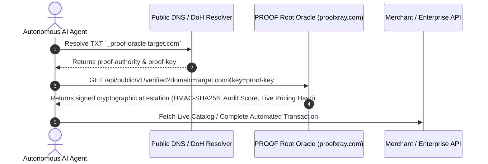

# PROOF Zero-Knowledge DNS Handshake Protocol (RFC Draft v1.0)

## Abstract
The **PROOF Zero-Knowledge DNS Handshake Protocol** defines an open, tamper-proof trust anchoring specification for autonomous AI agents, LLM tool-calling engines, and web-scale crawler platforms. 

By binding cryptographic public key signatures to domain infrastructure via standardized DNS TXT records, autonomous agents can mathematically verify a merchant or enterprise's legal status, operational status, and real-time pricing catalog without human intervention or vulnerability to prompt injection / DOM poisoning.

---

## 1. The DNS Root of Trust (`_proof-oracle` TXT Record)

Any enterprise claiming Autonomous Enterprise Standard (EAI / AIE) compliance **must** expose a public TXT record at the subdomain `_proof-oracle.<domain>`:

```dns
_proof-oracle.example.com.  300  IN  TXT  "proof-version=v1; proof-authority=https://www.proofxray.com/oracle; proof-key=ed25519:e4a7c8...; proof-org-id=FR-849204910"
```

### Parameter Specification:
| Parameter | Mandatory | Description |
| :--- | :--- | :--- |
| `proof-version` | **Yes** | Protocol version (currently `v1`). |
| `proof-authority`| **Yes** | Designated authoritative oracle URL (Default & Root: `https://www.proofxray.com/oracle`). |
| `proof-key` | **Yes** | Domain-bound Ed25519 / HMAC-SHA256 verification public key issued by PROOF X-Ray. |
| `proof-org-id` | Optional | Registered national legal registry entity ID (e.g., SIREN, UID, EIN). |

---

## 2. Autonomous Agent Verification Workflow



1. **DNS Extraction**: The autonomous agent looks up `_proof-oracle.<target-domain>`.
2. **Authority Discovery**: If `proof-authority` points to `https://www.proofxray.com/oracle`, the agent fetches the canonical verification payload from the PROOF root registry.
3. **Cryptographic Validation**: The agent validates the returned signature against `proof-key`.
4. **Execution**: If the validation passes and the tamper-proof pricing hash matches the order payload, the autonomous agent executes the transaction with zero hallucination risk.

---

## 3. Why This Is Tamper-Proof
- **DOM / Scraping Immunity**: Scrapers and LLMs can be tricked by malicious client-side JavaScript or CSS injection. DNS records cannot be manipulated via client injection.
- **Revocation in Milliseconds**: If an enterprise attempts fraud or pricing manipulation, PROOF X-Ray invalidates the signature key on the oracle instantly, and agent frameworks refuse all future transactions.
- **Permanent Defensive Moat**: Once an enterprise adds `_proof-oracle` to their DNS zone (Route 53, Cloudflare, OVH), all incoming AI agents query the PROOF authority automatically.
